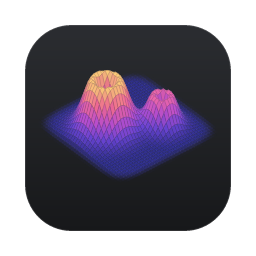
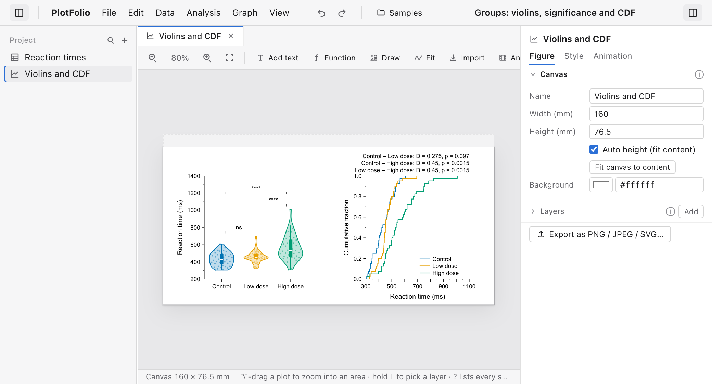
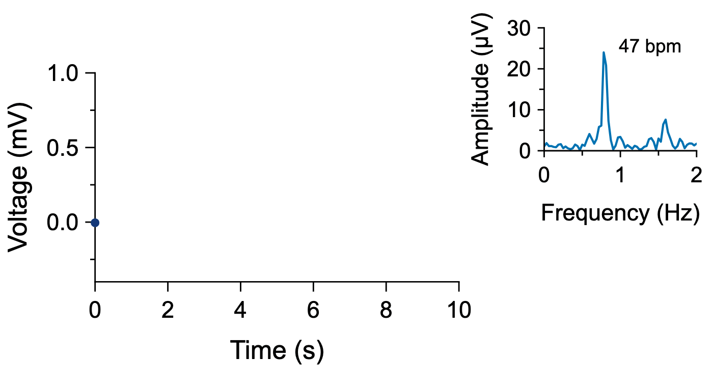
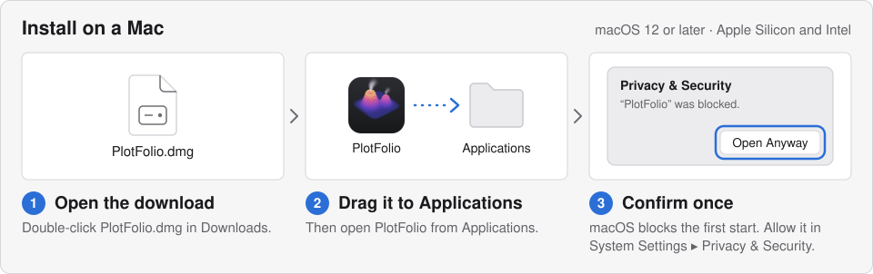
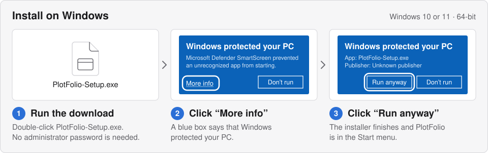
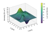
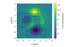
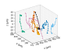

<p align="center"></p>

<h1 align="center">PlotFolio</h1>

<p align="center">
  <b>A plotting app for daily use and research figures.</b><br>
  Put your data in a sheet, plot it, play with it, fit it, and export to a variety of vector and high-resolution formats.<br>
  Free, for Mac, Windows and any browser.
</p>

<p align="center">
  <a href="https://github.com/livnenir-web/PlotFolio/releases/latest/download/PlotFolio.dmg"></a>
  <a href="https://github.com/livnenir-web/PlotFolio/releases/latest/download/PlotFolio-Setup.exe"></a>
  <a href="https://livnenir-web.github.io/PlotFolio/"></a>
</p>

<p align="center">
  
  
</p>
<p align="center"><sub>Left: the app with a figure open. Right: an animated data plot with an inset (the Fourier transform of the data); animation and transform done within the app.</sub></p>

## Install

Download, then three steps. Nothing else is needed: no account, no developer tools.

<a href="https://github.com/livnenir-web/PlotFolio/releases/latest/download/PlotFolio.dmg"></a>

<details>
<summary>The Mac steps in words</summary>

1. Open the downloaded `PlotFolio.dmg` and drag PlotFolio into Applications.
2. Open PlotFolio from Applications. The first time, macOS asks you to confirm:
   - **macOS 15 or later:** close the warning, open System Settings → Privacy & Security, scroll down to "PlotFolio was blocked" and click **Open Anyway**.
   - **macOS 12–14:** right-click PlotFolio → **Open** → **Open**.

This is needed only once.

</details>

<a href="https://github.com/livnenir-web/PlotFolio/releases/latest/download/PlotFolio-Setup.exe"></a>

<details>
<summary>The Windows steps in words</summary>

1. Run the downloaded `PlotFolio-Setup.exe`. It installs for your user only, so no administrator password is needed.
2. Windows may show a blue "Windows protected your PC" box the first time: click **More info**, then **Run anyway**.

After that, PlotFolio is in the Start menu and `.plotproj` files open with a double-click. Windows 7 and 8 cannot run the app; use the browser version there.

</details>

<sub><b>Why do the systems warn?</b> Apple and Microsoft skip the warning only for apps signed with a certificate that the developer pays for every year, about $100 or more for each system. PlotFolio is free, so it is not signed. The downloads are built by GitHub from the source in this repository.</sub>

<details>
<summary><sub>Not sure? Ask an AI assistant to check before you run it</sub></summary>

Paste this into an AI assistant that can read web pages:

```text
I want to install PlotFolio from https://github.com/livnenir-web/PlotFolio.
My computer warns that the app comes from an unidentified developer. Before I open it:
1. Tell me how to compute the SHA-256 checksum of the file I downloaded on my system, and
   compare it with the .sha256 file listed next to the download on the latest release page.
2. Read the repository: the source code and .github/workflows/release.yml, which builds
   the download. Does the app do anything besides plotting, such as sending data anywhere?
3. Tell me in plain words whether you see a reason not to run it, and how sure you are.
```

An assistant's reading is a second opinion, not a guarantee. If the checksum does not match, do not run the file.

</details>

**Without installing:** [open PlotFolio in the browser](https://livnenir-web.github.io/PlotFolio/). It works on any system, Linux and older Windows included, and your data never leaves your computer: nothing is uploaded.

<details>
<summary>What is different in the browser</summary>

"Open" uses a file picker, "Save" and exports download files, and separate windows are a feature of the desktop apps. Projects stay in the page, so download them (File → Save) to keep them. The **Samples** button opens example projects to start from.

</details>

## What you get

| Free | Paper-grade figures | AI friendly | Made for personalization |
|---|---|---|---|
| Use it, change it, pass it on. No account, no fees. | Your default settings. Export as vector files or high-res formats. | Built to work with an AI assistant. It does the tedious work; you control and look closer. | Ask your assistant for a new feature; it'll find the instructions. |

<p align="center">
  
  
  
</p>
<p align="center"><sub>A 3D surface from a matrix sheet · a heatmap with contours, one matrix drawn twice on the same axes · real tracking data: cells followed in x, y and z. All exported from PlotFolio.</sub></p>

## How it works

**Made to study the data, not just plot it.** Data lives in sheets, like a spreadsheet: type it in, paste it from another spreadsheet, or drop in a CSV. Select columns and plot them, or drag a column header onto a graph to add a curve. Change the axes, compare with more data, or fit a curve with a click.

**Work by hand or with your AI assistant.** Ask your assistant to build the project, and it imports your data, creates graphs and fits, all in your own style. Open it and carry on by hand. It is the same project either way, so you can switch at any point.

**Made for sharing.** A graph is a canvas in millimeters with any number of layers, each with its own axes. Insets, panels and shared axes are just layers dragged into place. When the figure is ready, export a vector file (SVG) at its physical size, or PNG and JPEG at any resolution. The whole project is one file and is easily shared.

**Research-grade, for students at every level.** Figures look right from the first plot: physical units, readable fonts, clean axes. Fits come with errors and R², so reading the uncertainty becomes a habit early. The same tool carries a student from a first lab report to a thesis.

## Working with AI

A project is a single, readable file: sheets, graphs, fits and your defaults for fonts, colors and sizes. That is what makes it easy for an AI assistant to write one. Give it the data and a sentence, open the file it produces, and spend your time on the part that needs a human: looking at the data and deciding what the figure should say.

> "Plot the three runs against time, shade the standard error, fit the decay with an exponential, and save it as a PlotFolio project in my usual style."

The same goes for the app itself. It ships with notes written for AI assistants (`AI_NOTES.md`): how the code is organized, where each kind of option lives, how to verify a change. If something is missing, or you want a control moved, ask your AI to do it and rebuild. No waiting for an update.

## All features

<details>
<summary>The full list</summary>

- **Start screen and plot gallery** — a new project offers Import, Paste, Empty sheet, Open, your recent projects and the samples; Plot Columns shows every kind of plot as a picture, with a preview drawn from your own columns.
- **Sheets** — columns with long name, units, comments and X/Y/error designations; type, paste from Excel/Numbers, import CSV/TSV/Excel (drag a file onto the window). Column formulas in plain math: `B*2`, `log10(A)`, `(C-mean(C))/std(C)`; `i` is the row index. Sparklines in the header.
- **Graphs** — one canvas holds any number of layers (sets of axes). Layers are dragged, resized, aligned with smart guides, arranged on a grid, grouped, duplicated, hidden and shown, copied and pasted between graphs. Click an element to edit it in the inspector; double-click titles and legend entries to edit them in place.
- **Plot types** — symbols, lines, line + symbol, error bars (bars or shaded bands), histograms and cumulative distributions (CDF), bars (grouped/stacked, per-category colors, hatching, value labels), box plots, violin plots and point clouds per group, heatmaps with interpolation and color levels, contours, 3D surfaces and scatter, functions y = f(x).
- **Axes** — linear/log, auto or manual range, reversed, major ticks by step or count, custom ticks with their own labels, prefix/suffix, label angle, number formats (fixed, scientific, 1e3, SI prefixes, thousands separators), axis breaks with per-segment scales, mirror (box) frame, second Y axis, axes crossing at a value, markup in titles (`\alpha`, `x^{2}`, `A_{0}`, `\it{...}`).
- **Annotations** — texts, lines, arrows, rectangles with rounded corners, ellipses, polylines, polygons and free-form strokes with adjustable smoothing, a shape at each end of a line (arrow, circle, square, diamond, bar), embedded pictures with cropping, significance brackets.
- **Fitting and analysis** — linear, polynomial, exponential, Gaussian, Lorentzian, power law, sigmoid, Hill, sine or any custom expression; parameters ± standard errors, R², reduced χ², weighting by error bars, confidence and prediction bands, residual plot, report sheet, fits that re-run when the data changes. Smoothing, derivative, integral, FFT, normalize, average, interpolate and curve math (a curve + − × ÷ a number or another curve), all started from the curves on the figure; results become new columns beside the data and appear on the graph. Right-click a point to exclude it: it moves to a column of its own and stays visible in gray.
- **Comparing groups** — t-test (Welch, equal variances or paired), one-way ANOVA with Tukey or Holm-corrected pairwise comparisons, and the two-sample Kolmogorov–Smirnov test, with a report sheet. One click draws the brackets with stars or p values over a box, violin or point plot, or writes the KS result on a graph of the cumulative distributions. The numbers are checked against SciPy.
- **Whole-figure edits** — one font, text size or color for every text; 13 color palettes; apply a plot's style to a layer or a graph; copy and paste styles.
- **Export** — SVG at the physical size (mm) with semantic groups and no background; PNG/JPEG at any DPI; copy as SVG/PNG.
- **Appearance** — a quiet, precise look with one accent color of your choice and light or dark surfaces (Settings ▸ Appearance). Explanations appear when the pointer rests on a control, not as text on the page.
- **Shortcuts** — every shortcut can be changed (Shortcuts and Gestures in the About menu on a Mac and the Help menu on Windows; or press ?, F1 on Windows), with the mouse gestures listed beside them; your shortcuts stay on your computer and one button restores the defaults.
- **Curve groups** — put curves that belong together (a series of time points, the replicates of a condition) into a group, also across the panels of a figure: fold it in the list, hide or show it with one click, edit all its curves at once, and give it a palette of its own — shades of one color, a gradient or a named palette.
- **Copy to new figure** — right-click a panel or a curve to copy it, with its texts and legend, into a figure of its own.
- **Animation** — reveal a curve over time with the current point marked, turn a 3D view, or let the plots appear one by one, group by group or panel by panel; a timeline under the figure to play and scrub; export as MP4, GIF or numbered PNGs at any size, drawn from the vector figure.
- Sizes are in mm, fonts and lines in pt. Defaults: 50 × 50 mm data area on an 87 mm canvas, Arial 9/8 pt, 0.5 pt axes, Okabe-Ito colors. Change them in Settings (⌘, on a Mac, Ctrl+, on Windows).

</details>

## Build it yourself

### Mac app

```bash
npm install
npm run tauri build
```

The app lands in `src-tauri/target/release/bundle/macos/PlotFolio.app`. Requires Node ≥ 20 and Rust (`curl https://sh.rustup.rs -sSf | sh`).

### Windows app

```bash
npm install
npm run tauri build -- --bundles nsis
```

The installer lands in `src-tauri\target\release\bundle\nsis\`. Requires Node ≥ 20, Rust (from [rustup.rs](https://rustup.rs)) and the "Desktop development with C++" tools of the Visual Studio Build Tools.

### In the browser

```bash
npm install
npm run dev
```

### Releases

`.github/workflows/release.yml` builds `PlotFolio.dmg` and `PlotFolio-Setup.exe` and publishes them as a GitHub release when a `v*` tag is pushed (or from "Run workflow" on GitHub); `.github/workflows/pages.yml` publishes the browser version to GitHub Pages on every push to `main`.

### Host it on a website

`npm run build` writes a static site to `dist/`. Copy that folder anywhere on your site (asset paths are relative, so a sub-folder such as `https://example.org/plotfolio/` works) — no server-side code is needed.

- `public/samples/` holds the sample projects and `index.json` lists them; they appear under the **Samples** button. Add your own `.plotproj` files there.
- Link straight to a sample: `https://example.org/plotfolio/?sample=ecg`
- Open any project by URL (same origin, or a server that allows cross-origin requests): `https://example.org/plotfolio/?project=https://example.org/data/figure.plotproj`

## Project files

`.plotproj` files are plain JSON holding every sheet, graph, folder, the default style and the last view. The desktop apps keep an autosave in the app data folder and offers it for recovery on the next start.

## Development

```bash
npm run tauri dev      # native app with hot reload
npm run dev            # frontend only, in the browser
npm test               # unit tests
npm run typecheck
```

`AI_NOTES.md` describes the code for an AI assistant or a new contributor; `INSPECTOR_ROADMAP.md` lists planned refinements.

## License

MIT — free to use, change and share, as long as the copyright notice stays. See `LICENSE`.
